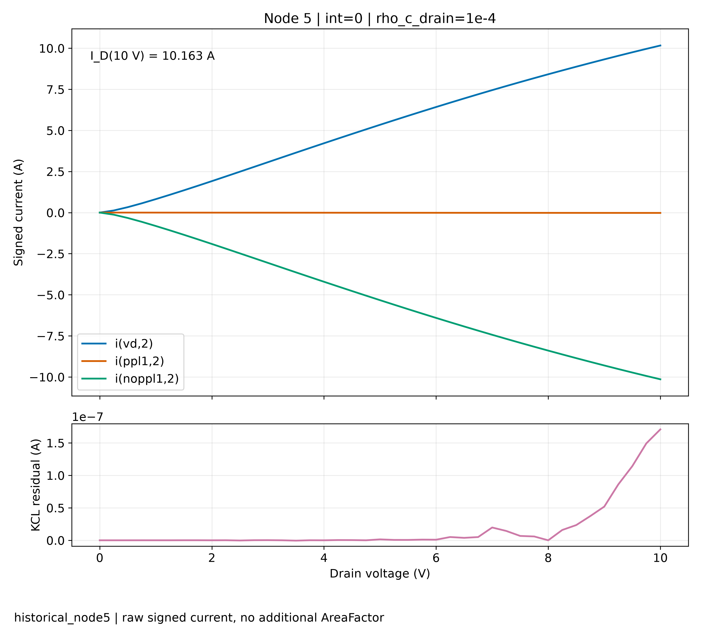
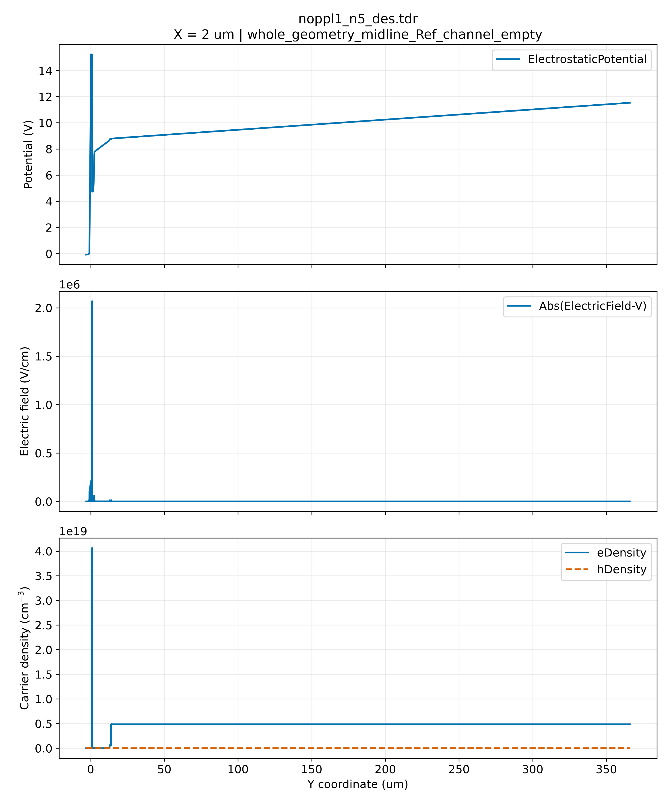
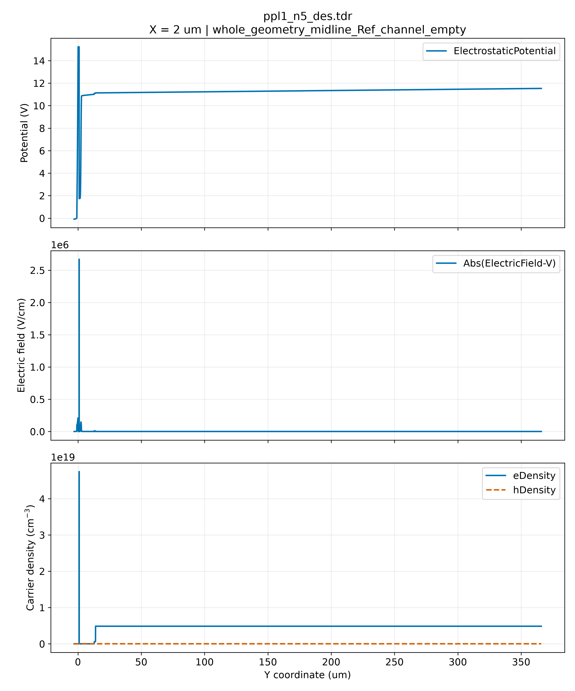

# TCAD 运行与结果报告

运行编号：`historical_node5`

更新时间：2026-10-22T12:34:36.138623+00:00。此页面是静态快照，需再次 refresh 才会更新。

## 问题与修改

本轮记录指定节点的已有输入、运行与结果；报告生成不修改物理模型、不提交新仿真。
研究假设及授权修改范围见对应任务文件。

## 输入与环境

实际工程：`未记录或不适用`
输入提交：`未记录或不适用`。历史记录无提交时保留为空，以输入哈希为依据。
任务：`未记录或不适用`；回收证据：`<LOCAL_WORKSPACE>\results\4E17SPICE_dark_flowcheck_20261019\node5_run_20261019T133220Z`。

## 运行与监控

状态：**historical_verified**；连接：未记录或不适用。
最近服务器监控：未记录或不适用；当前节点：未记录或不适用；阶段：未记录或不适用；已接受仿真时间：未记录或不适用 s；漏压：未记录或不适用 V。
上述时间为仿真时间，不是运行耗时；不预测剩余时间。
监控提示：`[]`

| 节点 | 状态 | 实际求解器版本 |
|---|---|---|

## 曲线与指标

| 节点 | int | rho_c_drain | 点数 | 最大 Vds/V | Id(10V)/A | 最大 KCL 残差/A |
|---|---|---|---|---|---|---|
| 5 | 0 | 1e-4 | 41 | 10.0 | 10.1630004406181 | 1.7078398961700714e-07 |

保留原始有符号电流，不再次乘 AreaFactor。KCL 残差为电源与两个器件支路电流之和。10 V 指标仅使用实际到达的点，不外推。

## 图表

节点 5：保留原始电流方向；下图为三支路电流之和。

## 空间分析

状态：numeric_verified_2D_images_blocked。

空间极值、截线坐标和状态依据：`spatial_20261022T125804_967539Z/`；数值清单及 CSV 与截线图存放在同一目录。

## 结论、限制与下一步

- 求解完成、数据导出、出图和报告完整性分别记录。失败、未运行与缺失数据分别保留。
- 单次求解收敛不等于物理模型或网格精度已验证。
- 当前 Id–Vd 数据不用于推导 Vth、击穿电压或热失控结论。
- 下一步仅提出建议：补齐缺失证据，核对曲线与空间分布；新计算需另行明确要求。

## 证据与异常

输入哈希、原始结果哈希、指标算法及 TDR 清单见 analysis.json；指标见 metrics.csv。

异常数：0。
